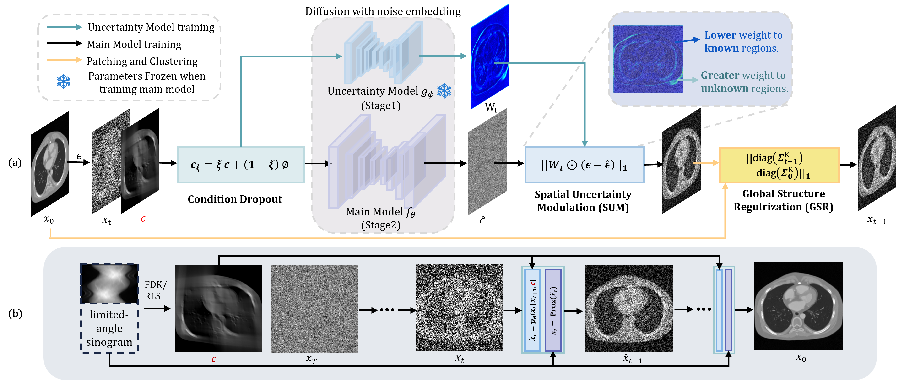

# DCI-diff

Official implementation of **DCI-diff: Data-Consistency-Inspired Diffusion Constraint for
Limited-Angle Cardiac CT Reconstruction**.


## Overview

DCI-diff combines a conditional diffusion prior with CT data consistency for limited-angle cardiac
CT reconstruction. The framework uses uncertainty-aware learning and global structure
regularization (GSR), while projection-domain consistency is enforced during iterative sampling.



*Overview of the DCI-diff framework. The final figure and caption will be updated with the paper.*

## Release status

| Component | Availability |
|---|---|
| Validation and inference code | Initial public release |
| Full training code and training configurations | After paper publication |
| Clinical data | Not released because of patient privacy restrictions |

The current repository is an early version and its interfaces, configuration files, and
documentation may change before the final release.

## Installation

Install the Python dependencies with:

```bash
pip install -r requirements.txt
```

PyTorch with CUDA is required. The CT projectors additionally require
[LEAP](https://github.com/LLNL/LEAP) with CUDA support:

- `leaptorch` for slice-wise fan-beam validation;
- `leapctype` for measured cone-beam volume reconstruction.

## Validation data

Slice-wise validation data are stored as `.npy` files named
`<patient_id>_<slice>.npy`:

```text
data/GE/test/
├── full_npy/             # reference slices
├── limited_npy_90/       # 90-degree limited-angle FDK inputs
└── limited_npy_120/      # 120-degree limited-angle FDK inputs
```

Each limited-angle `.npy` image is an axial slice extracted from a 3D FDK-reconstructed volume; it
is not an independently reconstructed 2D FBP image.

Dataset roots and validation patient IDs are configured in `config/GE.yml`. Setting
`patient_ids: null` evaluates all available patients.

Clinical data are not distributed with this repository. Users must prepare their own data in the
same layout and ensure that its intensity scale and acquisition geometry match the configuration.


## Slice-wise validation

Run the conditional diffusion prior without fan-beam data consistency:

```bash
bash test.sh --checkpoint <weights.pth> --angle 90
```

Enable fan-beam data consistency during sampling:

```bash
bash test.sh --checkpoint <weights.pth> --angle 90 --use_dc
```

Use `--angle 120` for 120-degree validation and `--patient-id <ID>` to evaluate one patient.

The slice-wise `--use_dc` path is intended for controlled validation and constructs its projection
observation from the reference image. Reconstruction from measured cone-beam projections uses the
separate volume pipeline below.

## Measured cone-beam reconstruction

Whole-volume reconstruction uses measured projections as both the source of the limited-angle FDK
condition volume and the data-consistency observation:

```bash
python sample_cone_beam.py \
    --projections data/projections/patient<ID>_adjusted.npy \
    --angle 90 \
    --checkpoint <weights.pth> \
    --device cuda:0
```

An optional reference volume can be supplied for evaluation only:

```bash
    --gt data/reference/<ID>/full_npy
```

See [CONE_BEAM.md](CONE_BEAM.md) for the expected projection shape, scanner geometry, memory
requirements, sampling parameters, and output format.


## Citation

The citation will be added after publication.

> DCI-diff: Data-Consistency-Inspired Diffusion Constraint for Limited-Angle Cardiac CT Reconstruction
